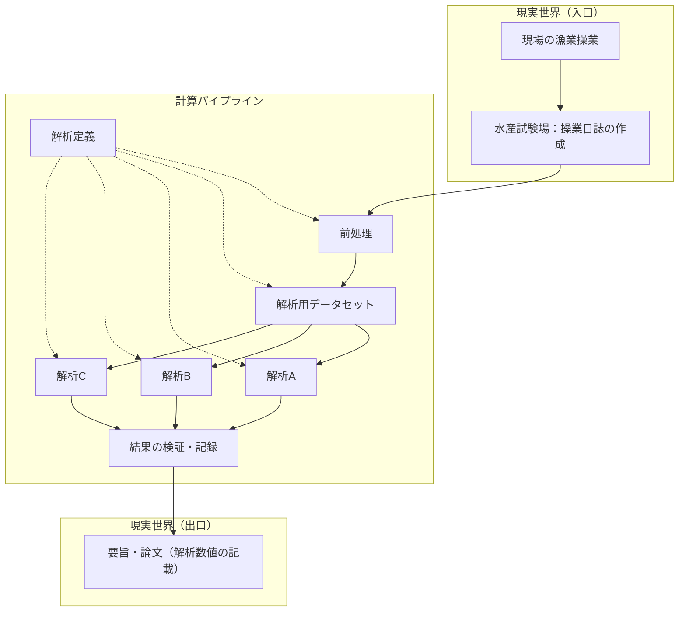

# 例：研究データ解析パイプラインの全体像

本ページは、実際の博士研究リポジトリに置かれた**再現可能な解析パイプライン**を、教材用に抽象化して示す。構造と処理の流れを理解することが目的であり、閾値・期間・検定結果などの**具体的数値は記載しない**（参照先もオープンリポジトリのため、定数や要旨向けの照合値は各リポジトリ内の定義ファイルに委ねる）。

**参照（実装の所在）**  
[DoctoralResearch — `analyses/P2/jsfo_2026`（`p2_poster` ブランチ）](https://github.com/Umiyomi/DoctoralResearch/tree/p2_poster/analyses/P2/jsfo_2026)

---

## この例が示すこと

- 現場の操業から日誌化、前処理、複数解析、成果物（要旨・論文）までを**一続きの流れ**として捉える
- 解析の前提（作業域、周期、イベントの定義など）を **設定ファイル** にまとめ、スクリプトは手順の実装に専念する構成
- 入口スクリプトが順序どおりに処理を実行し、**中間表・結果 JSON・実行記録**を出力する再現性の取り方

題材は、上記パイプラインが扱う**操業日誌に基づく位置・漁獲データ**である。操作的定義の詳細は参照リポジトリの README と spec に記載する。

---

## レイヤー構造（概念）

```text
現場の漁業 → 水産試験場による操業日誌の作成
  → 前処理（読込・品質管理・作業域など）
  → 解析用データセット（周期・イベントラベルなど）
  → 解析A / 解析B / 解析C（問いごとに並行）
  → 結果の検証・記録
  → 要旨・論文（解析数値の記載）
```

図の「解析A〜C」は、参照リポジトリでは共起・方向・漁獲など**独立した問い**に対応する。実装の細部（`src/` と `analyses/…/` の分担）は下表を参照。

---

## 処理フロー（抽象）



破線は、閾値・周期・対象条件など**解析定義が各段を拘束する**関係を表す。本ページでは段階名のみとし、数値は記載しない。

---

## 段階と参照リポジトリの対応

| 抽象段階 | 参照リポジトリでのおおよその対応 |
| --- | --- |
| 操業日誌の作成 | 試験場・漁業現場における日誌運用（パイプライン外） |
| 前処理 | 日誌の読込、品質管理、作業域・補助地理データ（`src/`、`load_days.py` 等） |
| 解析定義 | `spec.json` |
| 解析用データセット | 周期付与・適格条件・イベントラベル（`lunar.py`, `panel.py` → 中間表） |
| 解析A | 共起（近接と遠方の比較）（`cooccur.py`） |
| 解析B | 跳躍方向の一致（`direction.py`） |
| 解析C | 漁獲量の変化（`catch.py`） |
| 結果の検証・記録 | 並べ替え検定、出力 JSON、実行 manifest（`run.py`, `stats.py` 等） |
| 要旨・論文 | 学会要旨・原稿への数値の転記（パイプライン外。照合はリポジトリ内で行う） |

---

## 研究実践との対応（Part 1・2 との接続）

| パイプライン上の考え方 | 基礎演習で学ぶ要素 |
| --- | --- |
| 日次レコード・リスト化された観測 | 変数、`list`、`dict` |
| 条件による跳躍判定・近接区分 | `if` |
| 船団・日・周期ごとの繰り返し | `for` |
| 判定・集計手順の再利用 | 関数（`def`） |
| 定義と実装の分離（spec と脚本） | 検証思考（定義を変えたら何が変わるか） |
| 並べ替え・manifest | 偽成功を疑う（結果だけ見ず、手順と記録を確認） |

単一のノートブックにすべてを書くのではなく、**入力 → 中間データ → 複数解析 → 記録**と段を分けることで、仮説を棄却したり定義を見直したりするときに、どの段まで巻き戻すかを選びやすくなる。

---

## 読み方の注意

- 図中の名称は教材用の抽象表現であり、参照リポジトリのファイル名・ディレクトリ名と一致する部分もある。
- 閾値、対象船団数、解析期間、要旨との数値照合などは、**本ページでは意図的に省略**している。実装を追う場合は上記 GitHub リンク先の README と spec を正本とする。
